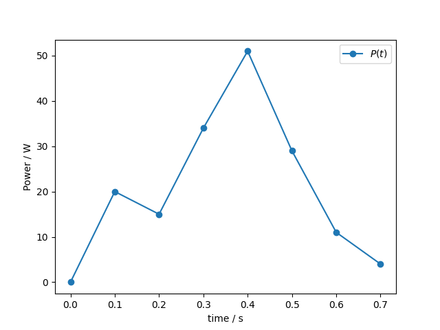

# Background: Overview of Function Representations

A _function_ is one of the most basic components of any mathematical model, and so it is very important in scientific computing to be able to represent functions in appropriate ways. The simplest way of thinking of a function is to simply have it be a function in the programming language, like this C++ function:

```cpp
double square(double x)
{
    return x*x;
}
```

or this Python function:

```python
def square(x):
    return x*x
```

But what if our function needs to be plotted? Or what if our function is not easily computable or expressed in our programming language? What if our function isn't an arithmetic function but a mapping between two finite sets of objects? Depending on the context, representing a function may require very different things from us, and so here we outline a variety of common function representations that you should be aware of and examples of their applications. 

## Computable Functions as C++ Functions / Callable Objects / Lambda Expressions

If we have an algorithm to calculate outputs from inputs, this can be represented directly as a function in the programming language. Most modern programming languages, including both Python and C++, provide ways of passing functions around like data: in C++ we have _function pointers_, _lambda expressions_, and _callable objects_. The various ways of handling functions in C++ can all be wrapped in the standard library type `std::function`, which we'll cover in this course. 

As a concrete example, suppose we want to write a function called `filter` that takes a list of integers and an arbitrary function $f: \mathbb N \rightarrow \mathbb B$ and returns a new list of all the elements $x$ where $f(x) = \text{True}$. We need a way of modelling an arbitrary function $f$ from integers to bools, for example to find all the even elements of a list. In Python the implementation could look like this:

```python
def filter(list_in, f):
    return [x for x in list_in if f(x)]

is_even = lambda x: (x%2) == 0

l1 = [1,2,3,4,5]
l2 = filter(l1, is_even)
```

In `filter`, `f` is an argument that is an arbitrary function which, applied to an element of the list, returns true or false. `is_even` is a _lambda expression_, which defines a function that checks if the input `x` is even. When we pass `is_even` into `filter` along with a list, we get the list of even elements back, but `filter` is very general because it will work for whatever function we decide to pass in takes integers and returns bools. 

The equivalent fragment in C++ would look like this:

```cpp
#include <functional>
#include <vector>

using std::vector;
using std::function;

vector<int> filter(const vector<int> &list_in, function<bool(int)> f)
{
    vector<int> output;
    for (auto x : list_in)
    {
        if (f(x))
        {
            output.push_back(x);
        }
    }
    return output;
}

int main()
{
    auto is_even = [](int x){return x%2 == 0;};

    vector<int> l1{1, 2, 3, 4, 5};
    vector<int> l2 = filter(l1, is_even);

    return 0;
}
```

Don't worry about the C++ syntax too much right now; the extra details will be explained as the course unfolds and is mostly there to support C++'s more rigorous programming style when it comes to types. It's more important to note that the structure is still the same: we have a lambda expression `is_even` which is a function that can be called that takes an integer and returns a boolen; it is passed to a function `filter` that takes a list of elements and an arbitrary function `f` and applies `f` to each element to determine which will be added to the output list. 

## Sampled Functions as Lists/Vectors

A sampled function means storing a series of values for a function for different inputs; it's a way of _discretising_ a function i.e. turning a continuous function (or signal) into a finite set of discrete points. You will likely be familiar with sampled functions from plotting graphs. Most plotting routines for a function $f(x)$ take a list of $(x, f(x))$ pairs (or a list $[x_0, ..., x_{n-1}]$ and a list $[f(x_0), ..., f(x_{n-1})]$).

Discretising functions is an important tool in science in engineering, and has myriad applications:

- capturing incoming signals from measurement equipment,
- representing numerical solutions to equations with no analytic form,
- pre-computing functions which are expensive to compute,
- calculating probability distributions by building up histograms of random events,
- and many more!

As an example, suppose we monitor _power usage_ at regular intervals. Physically, the total energy used is related to power by

$E = \int P \,dt$.

We don't have an analytic form of the function $P(t)$, so we can't integrate it analytically. Instead, we have a series of values for the power at different times, and we can integrate it using a numerical method such as the trapezium rule. We can visualise this representation of the power function as the plot below:



To integrate the function, we need to access the elements of an array of power / time values. The python code to integrate an arbitrary function $f(x)$ like this would look something like this:

```python
def trapezium_integrate(x, f):
    n = len(x)
    assert(len(f) == n)
    tot = 0
    for i in range(0, n-1):
        tot += (x[i+1] - x[i]) * (f[i+1] + f[i]) * 0.5
    return tot
```

and the equivalent C++ code like this:

```cpp
double trapezium_integrate(std::vector<double> x, std::vector<double> f)
{
    if(x.size() != f.size())
    {
        throw std::runtime_error("Number of sample points for x and f do not match.");
    }
    double tot = 0;
    for(std::size_t i = 0; i < x.size(); i++)
    {
        tot += (x[i+1] - x[i]) * (f[i+1] + f[i]) * 0.5;
    }
    return tot;
}
```

### Special Case: Interpolated Functions 

Sometimes when we have a discretised function we need to have a strategy for approximating values between the sample points. As well as providing values for the function at arbitrary points, these can also be used to calculate useful approximations of integrals and gradients.

Two of the most important interpolation schemes are:

- Linear interpolation: each sampled point is joined to the next by a straight line and values are calculated using $f(x) \approx f(x_i) + (f(x_{i+1}) - f(x_i))\frac{x - x_i}{x_{i+1} - x_i}$ for $x_i \le x \le x_{i+1}$. 
- Polynomial spline interpolation: segments of the function are approximated as polynomials (usually cubic) satisfying some constraints on the continuity of the function and its first derivative. 

## Discrete Functions as Associative Arrays (Maps/Dictionaries)

Although most functions in physical sciences are continuous functions over some continuous space like the real numbers, in computing we will very often have to deal with _discrete functions_, i.e. functions whose domain is a countable set. Common domains might be the natural numbers (for example, an ID for an object), characters/strings, a set of labels, and so on. 

Discrete functions can be represented using an _associative array_; in C++ the standard library provides `std::map`, and you may have come across Python's `dictionary` type which does the same job. An associative array stores _key-value pairs_, allowing you to look up a value for a particular key. When used to represent a function, the _key_ is an element of the domain, and the _value_ is an element of the range. 

Suppose we have a labelled graph, with a set of vertices $V$ and set of labels $L$. We may want to construct a function $f: L \rightarrow \mathcal{P}(V)$ that returns all the vertices with a given label. If our labels are strings, we can represent this function as an associative array (i.e. map or dictionary) from strings to integers (the ID of the vertex). We can see this clearly in the example code below in Python:

```python
def ConstructLabelSubsetFunction(graph):
    lsf = {}
    for i in range(graph.num_vertices):
        s = graph.get_label(i)
        if s in lsf.keys():
            lsf[s].append(i)
        else:
            lsf[s] = [i]
    return lsf
```

and in C++:
```cpp
std::map<std::string, std::vector<int>> ConstructLabelSubsetFunction(LabelledGraph graph)
{
    std::map<std::string, std::vector<int>> lsf;
    for(int i = 0; i < graph.num_vertices; i++)
    {
        std::string s = graph.get_label(i);
        lsf[s].push_back(i);
    }
    return lsf;
}
```

Note that we have taken the implementation of the labelled graph data structure to be implicit; all we have required here is that we can get the number of vertices and the label of a given vertex. 

You may notice that this example does have an algorithmic implementation: instead of constructing a map we could instead iterate over all of our vertices every time we want to find the set of vertices with a given label. If we need to query this function frequently, this approach is likely to be much less efficient than constructing our map once and then finding the result for each label easily. 

Maps are also useful for constructing functions that have no clear algorithmic form, for example if we are constructing a mapping based on run time input or data files. 