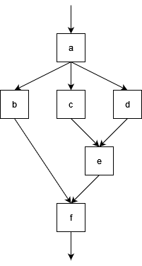

## Parallel Computing Paradigms

So far in this course we've been writing mostly **sequential** programs, where the code runs from start to finish, each step one after another. We've previously introduced to SIMD instructions (single instruction, multiple data) where CPUs can optimise the application of a single instruction to multiple pieces of data when appropriate. This week we move into the world of MIMD (multiple instructions, multiple data). Modern **multi-core** CPUs are perfectly capable of performing many *different* operations completely independently of one another, i.e. in **parallel**. If we can split up a problem into pieces and run each piece in parallel, we can achieve impressive performance improvements.

## Why do we need parallel programming?

We as researchers turn to parallel computing when our codes either are too slow (even with the best single-core performance) or take up too much memory to fit inside one system's memory space. For a quick motivating example, consider the fastest supercomputer in the world: [Frontier](https://en.wikipedia.org/wiki/Frontier_(supercomputer)). In total it has around 600,000 CPU cores, and several GPUs as well but let's just consider the CPU power here. Codes tend to only use a fraction of a large supercomputer like this at one time, so let's assume a code is only using 10%: 60,000 cores. If a code runs for a single day on this piece of Frontier, a version of that same code where all computation is done on a single core could run for over 150 years. These kinds of codes rarely run for as short a time as a single day, some simulations taking over a month to complete. You can imagine the insignificant size of problems we could solve if we couldn't use parallel computing.

You might be asking, why not just make CPUs faster and process more data per second. Why do we even need parallelism at all? While CPU clock speeds would increase by nearly a thousand times between the first microprocessor (in the 1970s) and now, and clever tricks inside the CPU allows even more instructions per second to be carried out, the fundamental physics of power and frequency in electronic components limit the processing speed of single-core CPUs. See [Wikipedia on Frequency Scaling](https://en.wikipedia.org/wiki/Frequency_scaling) for more details on power barriers in CPU design.

## What problems can be parallelised?

Let's take a moment now to discuss the kinds of problems that *can* be parallelised. Fundamentally, **only problems that can be split into individual chunks and *processed independently* can be parallelised**. If one piece of computation depends on another, it *cannot* happen in parallel. Some examples of parallel tasks include:

- processing individual cells in a grid-based simulations
- simulating non-interacting particles
- processing orders in a restaurant
- searching for strings in a piece of text
- Monte-Carlo simulations

However, some tasks simply cannot be parallelised:

- all steps in baking a cake
- reading a text in order
- synchronous point to point communications

In essence, if there is a prescribed order to tasks, where one *must* complete before another, it is unlikely that they can be parallelised.

A useful way of revealing the parallelism of problem is to express the dependencies using a directed acyclic graph (DAG), as shown below.

In this dependency graph tasks are represented by labelled boxes (vertices), and dependencies are represented using arraows (directed edges). Task $a$ has no dependencies and so can act as an entry point to our computation. Tasks $b$, $c$, and $d$ all depend on the completion of $a$ but do not depend on each other, and so can be done in parallel. $e$ depends only on $c$ and $d$, so can be computed once those are done even if $b$ is not finished yet. $f$ requires both $b$ and $e$ to be completed. 

The most common places that we will parallelise are _loops_, where the same code is executed many times, often on different elements of an array. Iterations of a loop can be executed in parallel _if they are independent_, i.e. if the calculation of one loop iteration does not depend on the result of any previous iterations. 
