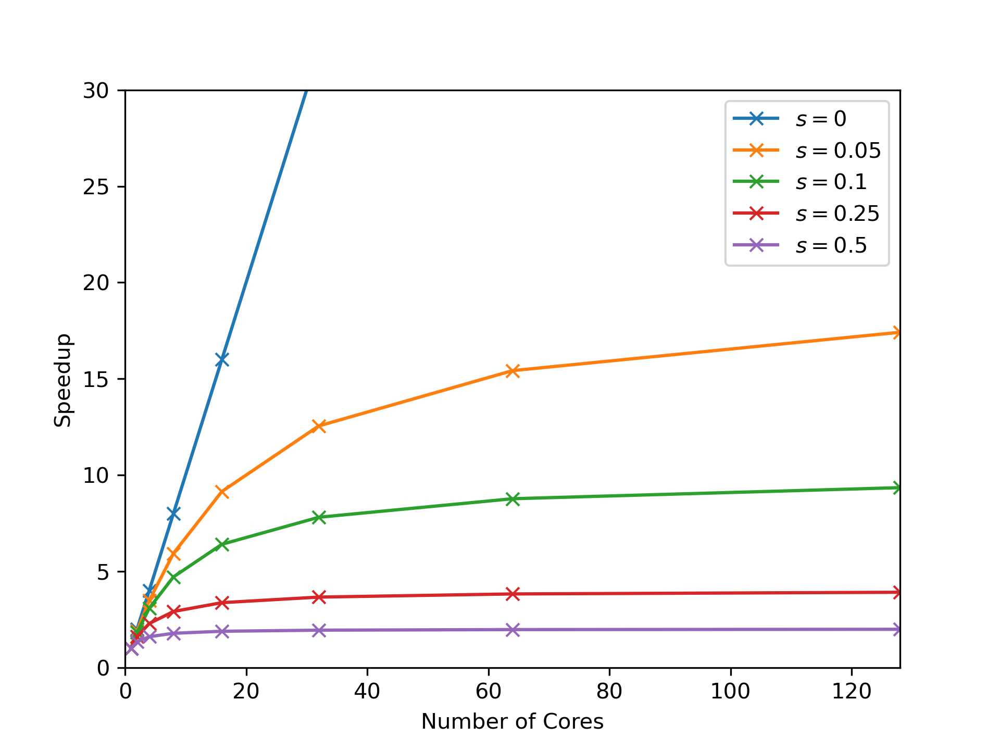

# Performance in Parallel Programs

## Scaling of Parallel Programs

In example 4 we were able to measure the **parallel scaling** of our parallelisation. In particular, we measured the code's **strong scaling** performance, that is keeping the **problem size** constant and measuring how the runtime changes with the number of threads. We can experiment with other kinds of important measures like memory and power scaling instead of runtime but most scaling experiments focus on measuring the runtime performance so that is what we'll focus on here.

A useful measure when measuring scaling is **speedup**, a measure of how much faster a code completes when run with a higher number of threads. In parallel programming this is usually calculated as the ratio of the single-core time to a higher-core time. In the previous example the speedup I achieved moving from 1 to 4 threads was approximately $0.07/0.021 = 3.33$. This can be written as "3.33x" as in "3.33 times the single-core speed" or even just $3.33$ when it's obvious it's referring to a speedup.[^speedup]

[^speedup]: Speedup doesn't just refer to speedup due to adding more threads to a parallel code. Any time we change a code and make it run faster, we can measure the speedup as the old runtime divided by the new runtime.

While problem size is relatively easy to quantify in the sum example; it's just `N`, the number of items in our vector, it's not always so straightforward. In my own experience, there tends to be one or two obvious numbers that represent the overall problem size but unfortunately there is a bit of an art to identifying a variable within a complex code that can act as a measure of "problem size". Many problems will have multiple ways to measure their size in some sense, so scaling experiments may be run by varying different variables to understand how the parallelisation affects different aspects of a given problem.

#### Strong scaling

There are two main kinds of parallel scaling found in HPC literature: **strong scaling**, keeping the problem size constant and changing the number of thread, and **weak scaling**, changing the problem size *and* the number of threads by the same factor. In a strong scaling experiment we decrease the amount of work per thread as we increase the number of threads, but in a weak scaling one the amount of work per thread stays constant.

### Weak scaling

Example source: `05_weak_scaling/` in the [examples repository][examples-repository].

Let's now run a weak scaling experiment using the same code as example 4, but this time we will increase the problem size by the same factor as we increase the number of threads; if we double the number of threads, we will also double `N`. In practice, we will simply multiply the initial problem size by the number of threads inside the code. The code is so similar to the previous example I won't print it here but you should read through it to make sure you understand what's going on. Now, as I increase `OMP_NUM_THREADS` from 1 to 8 I see my time increase slowly from 1 threads to 4 then more quickly from 5 threads to 8:

| `OMP_NUM_THREADS` | `N` | Time (s) |
|---|---|---|
| 1 | 100000000 | 0.0704839 |
| 2 | 200000000 | 0.0727549 |
| 3 | 300000000 | 0.0746549 |
| 4 | 400000000 | 0.0785764 |
| 5 | 500000000 | 0.101448 |
| 6 | 600000000 | 0.135992 |
| 7 | 700000000 | 0.185243 |
| 8 | 800000000 | 0.205911 |

What does this data say about the parallelisation or even my hardware? We see *nearly* ideal scaling changing the number of threads from 1 to 4 (remember ideal weak scaling looks like constant time with increasing threads and problem size). Nearly ideal in this case means it only increases very slowly, i.e. the speedup is just larger than $1$. This is good, we now know we can run problems 4 times as large in nearly the same amount of time if we use 4 times as many threads (for smaller number of threads). The frankly terrible scaling after that, when using 5 threads to 8, suggests that there is possibly some fundamental difference between some of the cores in my CPU, where using them slows down the overall computation. Or, perhaps my CPU is throttling its speed to control its temperature as I try and use more cores. If I were measuring a real code, at this point I would probably run a similar experiment on a different CPU to try and understand better what is happening.

### Why measure scaling performance?

In example 4 we saw that, on my machine at least, providing 4 threads gave us the best runtime performance. In fact, if I naively assumed my code runs fastest with the most number of threads, I'd end up waiting nearly 30% longer for my results. I couldn't have known that information without performing some scaling experiment. So if I'm not making any changes to my code, I know I should just run this with 4 thread for the best performance. If I am willing to do more work, I could start with this data and begin optimising my code for higher thread counts. Perhaps there is a different sum algorithm I can use that works better for high thread counts, or perhaps there are some options within OpenMP I haven't considered. Performing a parallel scaling experiment is the first step to improving the overall performance of my code. This data also tells me something about how I should expect my code to run on other machines. If I didn't have the data I could (again) naively assume my code could be faster on a machine with more cores, perhaps leading me to waste resources on gaining access to a machine with cores my code can't even use.

In short parallel scaling experiments allow us to:

1. Find the ideal number of threads for the best performance on a given machine.
2. Inform optimisation efforts.
3. Suggest how the code will run on different hardware.

We measure *both* strong and weak scaling because they help us better understand how we can use our code to achieve our science goals *in different ways*. If I have very good strong scaling, that is my code gets significantly faster when I add more threads, I know I can run similarly sized problems in less time if I just have a bigger computer. If I have very good weak scaling, I know I can run much larger problems on a larger machine and they should run in about the same amount of time. Strong and weak scaling characteristics can vary independently; some codes will scale very well in a strong sense, but not well in a weak sense, and vice versa. If your code doesn't scale well in either I suggest you rewrite your algorithm or look at your parallelisation.

Scaling itself can even change as a function of problem size or number of threads. Many linear algorithm packages will use different algorithms for different problem sizes because the scaling changes with the problem size. Similarly, you may find an algorithm that performs poorly at lower thread counts actually becomes better than alternatives with higher thread counts.

### Ideal scaling: a fantasy?

The **ideal scaling** or **perfect scaling** in a strong scaling experiment would be a linear improvement in performance with an increase in threads, i.e. if I double the number of threads I use to run my perfectly scaling code, I should expect it to run in half the time, or twice as fast. In terms of speedup, perfect strong scaling implies that the speedup with $N$ threads should be $N$.

In a weak scaling experiment, perfect scaling would result in the code taking exactly the same amount of time as we increase thread count and problem size by the same factor[^superlinear-scaling]. In a perfectly weak scaling code, the speedup should be exactly $1$ with any number of threads[^problem-size-weak].

[^superlinear-scaling]: There are some circumstances where we can actually achieve better than perfect scaling, or superlinear scaling. It's rather rare so I won't discuss further but look out for the excitement surrounding superlinear parallel codes and (somewhat related) superlinear algorithms.

[^problem-size-weak]: Actually perfect weak scaling may look different for different definitions of problem size, particularly if the problem scales nonlinearly with a chosen measure of problem size.

For most real problems, ideal scaling is impossible to achieve due to most problems containing fundamentally *serial* sections. Even in our sum example, although each thread sums its own piece of the loop, at the end of the loop OpenMP must still add up those individual sums into the final result sequentially. We can quantify the impact of this serial part on our parallel performance through **Amdahl's law**:

$\text{speedup}_{\text{ideal}} = \frac{1}{s + \frac{1-s}{N}}$

Here, $s$ is a measure of the proportion of the code's runtime that *must* happen serially, $N$ is the number of threads, and $\text{speedup}_{\text{ideal}}$ is the best possible speedup we can achieve using $N$ threads. I recommend you convince yourself this is correct. The way I do this myself is my considering that if my runtime is $1$s, it is split between $s$ seconds spent serially and $1-s$ spend possibly in parallel. With perfect strong scaling, that $1-s$ runtime should decrease as $(1-s)/N$ for $N$ threads, but my serial portion takes the same amount of time, so my total runtime becomes $s + (1-s)/N$. My speedup is then the inverse of this, which is Amdahl's law.

So, for example, if I'm able to parallelise a portion of my code I *know* takes 80% of the runtime, leaving 20% running serially, $s=0.2$. If I have $4$ cores available, Amdahl's law tells me I can achieve *at best* a speedup of 2.5x. This is significantly lower than the ideal speedup of 4x using 4 threads. With 16 threads, I can achieve a maximum speedup of 4x.

You can see that if only 80% of your code's runtime is parallelised, we reach a point of diminishing returns very quickly in terms of the number of threads we can offer our code. Because of the nonlinear nature of Amdahl's law, for *any* value of $s$ we will eventually reach a point where adding more threads doesn't provide a meaningful improvement in performance. In fact, if we imagine $N$ going to infinity in the above equation, we see the parallel part of Amdahl's law, $(1-s)/N$, becomes insignificant compared to $s$, and so the ideal speedup with infinite threads is $1/s$. You can begin to see that in the following plot of Amdahl's law for different values of $s$:



Just like our scaling experiments, Amdahl's law provides a useful guide in helping us understand the limits of our code's parallelisation. With a code that spends a significant amount of time performing work serially, we're better off spending our time trying to parallelise the dominant serial parts or trying to at least optimise them to reduce their contribution to the runtime, rather than trying to run our code on a machine with more threads.


## Cache Performance in Shared Memory

The need for cache efficiency hasn't gone away just because we've started parallelising things; in fact, it may be more important than ever! Generally for distributed systems we just need to worry about the cache efficiency of each process in isolation, but if memory is shared then that means our cache gets shared too. The way that our cache behaves when shared is a little different though, so we'll need to re-think how we do things a bit.

As always with the memory system, things will be system dependent, but on a typical CPU:

- General RAM and the largest cache level will be shared between cores which share memory i.e. there
  is just one physical RAM and one large physical cache (in my case just the L3 cache) which is
  accessed by all cores. (Not all cores necessarily access memory with equal bandwidth or latency
  though.)
- Each core will have its own copy of the smallest cache level(s), in my case it's the L1 and L2 caches.
- This keeps access to the small caches quick, but also enforces the need to consistency between the
  copies of the caches.

  - If I have two cores $C_1$ and $C_2$ which both store a copy of variable `x` in their L1 cache, then when they want to read `x` from memory they just read it from the cache and not from RAM. Likewise when they want to _write_ to `x`, they write to the cache but not RAM.
  - If $C_1$ changes `x`, it will change the value of `x` in _its own cache_, but not in the $C_2$ cache.
  - In order for $C_2$ to read the correct value of `x` after the update, it has to find out about the change somehow.
  - This mechanism will be system dependent but typically it will involve something written to a
    special shared area (possibly part of the L3 cache) when $C_1$ updates `x`. $C_2$ needs to
    check this and if `x` has been changed it needs to get the new value of `x` which will need to
    be copied over, incurring additional overheads.

- Remember that the cache stores data in blocks of a given size, called "cache lines". The cache lines on my machine for example are 64 bytes or 8 doubles wide.
- If two L1 caches on different cores both store the same cache line, and one of the cores changes
  _any value in that line_, then **the entire cache line is invalidated for the other core**.

  - This is extremely important as it means that even if the two cores never operate on the same values, if the values that they operate on are next to each other in memory and stored in the same cache line, then they will still invalidate one another's caches and cause lookups to have to be made.

As a very simple example, let's look at a possible manual implementation of the reduction code shown in this week's class. I'll do this example with no compiler optimisations to prevent the compiler optimising away any memory read/write operations so we have full control! As a reminder, the basic code looks like this:

```cpp
#include <iostream>
#include <vector>
#include <cmath>
#include "timer.hpp"
#include <omp.h>

using namespace std;

int main() {
  const int num_threads = omp_get_max_threads();

  double sum = 0.;

  Timer timer;

#pragma omp parallel for
  for(long i=0; i<N; ++i) {
    double x = i*dx;
    sum += 4.0f/(1.0f + x*x)*dx;
  }

  double elapsed = timer.elapsed();

  std::cout << "Time: " << elapsed << '\n';
  std::cout << "Result: " << sum << '\n';

  return 0;
}
```

- We know that this loop is both slow and inaccurate because of the data race problems discussed last week.
- We can fix this using OMP's built in reductions.
- Using 4 threads and the standard parallel sum reduction I get a time of 0.75 seconds for this sum. (My single threaded time is 2.05 seconds.)

Let's examine a simple reduction by hand though as an illustration of memory access patterns. We'll allocate some memory to hold each of our partial sums, and then get each thread to only interact with its own partial sum, and add them all together at the end.

```cpp
int main() {
  const long N =   1'000'000'000;
  const double dx = 1.0f/(N-1);
  const int num_threads = omp_get_max_threads();

  double sum = 0.;

  double *partial_sums = new double[num_threads];

  Timer timer;

  #pragma omp parallel
  {
    int n = omp_get_thread_num();
    partial_sums[n] = 0.;

    #pragma omp for
    for(long i=0; i<N; ++i) {
      double x = i*dx;
      partial_sums[n] += 4.0f/(1.0f + x*x)*dx;
    }
  }

  for(int i = 0; i < num_threads; i++)
  {
    sum += partial_sums[i];
  }

  double elapsed = timer.elapsed();

  std::cout << "Time: " << elapsed << '\n';
  std::cout << "Result: " << sum << '\n';

  delete[] partial_sums;

  return 0;
}
```

- My result is 3.14159, which is correct, which suggests that we have solved our data race problem.
- My time however is 2.10 seconds, so we've lost our performance boost! What is going on?
- Each of our partial sums is next to one another in memory, and could even all fit in the same cache line since there are only 4 doubles.
- Every time any thread updates its partial sum, any other thread whose partial sum is on the same cache line (which could be all of them!) will have its partial sum invalidated leading to a slower memory access.
- This overhead is incurred at every single step in our loop for every thread!

We can show that this is the problem by moving our variables to separate cache lines. We can force this to happen by buffering our partial sum array, since the array has to be contiguous. In my case, my cache is 64 bytes or 8 doubles wide, so we have to make sure there is an extra 7 doubles worth of space between each value in memory.

```cpp
int main() {
  const long N =   1'000'000'000;
  const double dx = 1.0f/(N-1);
  const int num_threads = omp_get_max_threads();

  double sum = 0.;

  int LINE_SIZE = 8;
  double *partial_sums = new double[num_threads*8];

  Timer timer;

  #pragma omp parallel
  {
    int n = omp_get_thread_num()*8;
    partial_sums[n] = 0.;

    #pragma omp for
    for(long i=0; i<N; ++i) {
      double x = i*dx;
      partial_sums[n] += 4.0f/(1.0f + x*x)*dx;
    }
  }

  for(int i = 0; i < num_threads; i++)
  {
    sum += partial_sums[8*i];
  }

  double elapsed = timer.elapsed();

  std::cout << "Time: " << elapsed << '\n';
  std::cout << "Result: " << sum << '\n';

  delete[] partial_sums;

  return 0;
}
```

- By placing each partial sum 8 elements apart instead of 1 element apart, we force each value to exist on a different cache line.
- Now all my partial sums can be in the cache at the same time _and_ updating them will not interfere with one another at all.
- My time for this sum with four cores is 0.84s, almost back down to our OMP reduction time.

The additional overhead is for the dereferencing operations, since we haven't compiled with optimisations. If for example we introduce a private variable to dereference the memory outside the for loop:

```cpp
  #pragma omp parallel
  {
    int n = omp_get_thread_num()*8;
    double &private_sum = partial_sums[n];
    private_sum = 0.;

    #pragma omp for
    for(long i=0; i<N; ++i) {
      double x = i*dx;
      private_sum += 4.0f/(1.0f + x*x)*dx;
    }
  }
```

then my time drops back down to 0.75 seconds.

Don't worry too much if your threads access _some_ memory that lies next to memory accessed by another thread - most problems will have to divide up memory in a way that shares some kind of boundary! But if your threads are spending a lot of time accessing memory next to one another it can cause serious performance issues. Having thread work on contiguous blocks of data in an array for example is better than having threads work on data that is interleaved with other threads.

## Estimating Performance in Message Passing 

Message passing naturally incurs a performance overhead. Data communication channels between processes are generally speaking much slower than straight-forward reads to RAM. As such, when designing distributed systems we should bear in mind:
- The frequency of message passing should be kept down where possible. 
- The size of messages should be kept down where possible. 
- In general, a smaller number of large messages is better than a large number of small messages _for a given amount of data_. 
    - This is true in general of data movement, whether through message passing or memory reads to RAM or hard disks. Data movement generally involves a latency ($L$), which is a time overhead for every message regardless of size, and bandwidth ($B$), which is the amount of data that can be transferred in a given time. 
- The time for $N$ bytes of data to be transferred in $k$ messages can be estimated using $t \approx N/B + kL$. 
    - If you have to choose between sending a smaller amount of total data in a larger number of messages, or a larger amount of data using a smaller number of messages, then which you should pick will depend on which term in this expression becomes dominant! 
    - In practice, this may need to be measured using suitable benchmarks to take into account issues more complex than this simple model can capture, such as network topology.


## Putting Things Together: Performance at Every Scale 

Over the last few weeks we've looked at a few different ways of approaching performance programming in isolation, but it's important to remember that we can (and should!) combine these principles where appropriate. 

### Mixing Distributed and Shared Memory Models

Distributed memory models have a lot of advantages in terms of simplifying memory management and allowing for much more complex systems involving different machines. However, data sharing in distributed systems is slow, which makes them very poorly suited to parallelising certain kinds of problems which involve substantial data sharing. There'd be no point in using a distributed system to transpose a matrix in parallel because passing the matrix components between processes would take longer than the memory reads to perform the transpose itself! But a matrix transpose _does_ parallelise easily in a shared memory system, and if you do an out of place transpose there is no chance of writing to the same place in memory! Many of our basic list and matrix methods make more sense to perform with shared memory parallelism to avoid the messaging overheads.

As an example of a complex problem which can take advantage of multiple levels of parallelism, let's consider likelihood sampling, a very common need in scientific applications. We have some parameter space which defines our model (for example properties of the universe that we want to measure in physics, or parameters describing a disease in epidemiology) and we have a set of points in this space which represent models with different sets of values for these parameters, and we want to calculate the likelihood of each of these sets of parameters given the data that we have. This is how we _infer_ model parameters from data. Calculating the likelihood will involve generating some observables from a model (i.e. calculating some function of these parameters), and doing some kind of multi-variate Gaussian (to compare to the data). 

- Each model evaluation and likelihood calculation is computationally expensive, but only needs a small amount of data to initialise (just the set of parameters)[^data]. This is a perfect example of something which can be allocated to separate processes in a distributed model! Each process is allocated one point in the parameter space and calculates the likelihood. There is no need for communication between processes to calculate the likelihood since they all work on independent points, and they only need to send a message to the parent process when they are done to report the calculated likelihood (again a very small amount of data). 
- The likelihood calculation itself will generally involve a lot of steps which need to be ordered (we tend to calculate a lot of functions which depend on the results of other functions etc. in scientific applications) and some linear algebera (for our multi-variate Gaussian we will need to handle the $x^T \Sigma^{-1} x$ term for our covariance matrix $\Sigma$, which itself may need to be generated for each point). This would mean a lot of communication and potential stalls if we were to try to parallelise these operations in a distributed way, but likely some good opportunities for threading when we need to deal with vectors, matrices, integrations and so on. So each process could also be multi-threaded on cores with shared memory.

[^data]: The observable data _does_ need to be communicated to every process, _but only once_ since it does not change. So for each new calculation we only need the new parameter set.