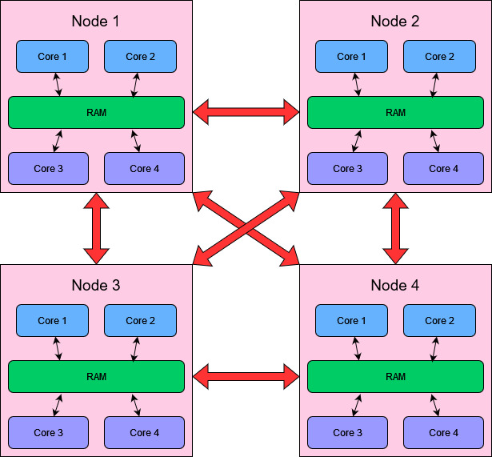
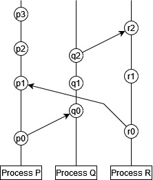

# The Distributed Memory Model of Parallel Programming 

Last week we looked at the use of shared memory parallel programming. As a reminder, the shared memory model is used when each thread has access to the same memory space. 
- Shared memory means that all threads can rapidly access the full data set.
- Can lead to awkward problems like data races. 
- Sometimes requires additional structures like mutexes to be introduced. 
    - A mutex can refer to any solution which means that a variable can only be accessed by a single thread at a time. It is a contraction of "mutually exclusive".
- The more concurrent threads we have operating on shared memory, the more pressure we put on resources which require access controls like mutexes, which can delay our program execution. 
- Shared memory is limited by the number of cores which can share on-chip RAM. This is generally not a very large number, even for high performance computing resources. The more cores we try to connect to a single piece of memory, the more latency there will be for at least some of these cores, and the more independent ports the memory banks will need to have.

In the distributed memory model, we take the parallelisable part of our program and split it up into independent _processes_. These processes each have their own memory space which cannot be accessed directly by any other process. Processes are however allowed to communicate with one another by sending _messages_; these can be used to send data back and forth between processes where necessary. This message passing is vital for:
- Initialising each process with the correct information. 
- Keeping processes synchronised where necessary (similar to how we used `barrier` in OpenMP).
- Aggregating results from multiple processes into a complete solution. 

Distributed memory programming is incredibly broad and flexible, as we've only specified that there are processes with private memory and some kind of message passing. We've said nothing about what each of the processes _does_ (they can all do entirely different things; not just different tasks but even entirely different programs), what those processes run _on_ (you could have many nodes in a cluster or a series of completely different devices), or what medium they use to communicate (they can all be directly linked up or they could be communicated over channels like the internet). The distributed memory model can apply to anything from running a simple program with different initial conditions on a handful of nodes in a cluster to running a client-server application with many users on computers and mobile devices to a world-wide payment system involving many different potential individuals, institutions, devices, and software. It can even apply to separate processes running on the _same core_ or on cores with shared memory, as long as the memory is partitioned in such a way that the processes cannot _access_ the same memory. (Remember when you write programs you use _virtual memory addresses_ which are mapped to a limited subset of memory as allocated by your OS; you generally have many processes running on the same core or set of cores with access to non-overlapping subsets of RAM.) 

For our purposes, we will focus on code written for a multi-node HPC cluster, such as [UCL's Myriad cluster](https://www.rc.ucl.ac.uk/docs/Clusters/Myriad/), using the [MPI (Message Passing Interface) standard](https://www.mpi-forum.org/). We will, naturally, do our programming with C++, but it is worth noting that the MPI standard has been implemented for many languages including C, C#, Fortran, and Python. We will use the [Open MPI](https://www.open-mpi.org/) implementation. We won't be covering much programming in this section, but focussing on the models that we use and their implications. 

## Aside: Task Parallelism

It's worth addressing the fact that different processes or threads don't need to do identical work. If we need to calculate something of the form:

$y = f(x) + g(x)$

then we can assign the calculation of $f(x)$ and $g(x)$ to separate processes or threads to run concurrently. Then there needs to be some kind of synchronisation (using a barrier or message passing) to bring the results together when they're both finished and calculate $y$. 

This kind of parallelism is called _task parallelism_, and can be extremely useful when optimising your code. This is particularly important when the calculations $f(x)$ and $g(x)$ are not themselves parallelisable (at least not to the extent which exhausts your resources). Then, rather than having resources standing idle, you can calculate them both at the same time. If however, $f(x)$ and $g(x)$ both parallelise when to use up all your resources with good scaling, then you will do just as well to calculate one of them after the other rather than calculating them both concurrently but twice as slowly. 

## Basic Structure of an HPC Cluster

The basic model that we need to know is as follows:

- Clusters are composed of _nodes_. 
    - Nodes can communicate with one another through the sending of messages. 
    - The latency associated with message passing may vary depending on the specific structure and connectivity of the nodes. Nodes which are "far apart" in some sense have longer message latency. This factor is difficult to control for unless you are very familiar with your architecture and can control which processes end up on which node, so in general it is not something to worry too much about! 
    - For now we will treat each node as being able to directly communicate with every other node. We can write programs with this assumption because messages can be passed between any two nodes regardless of exact network topology, so this detail is not important unless we are trying to optimise for message passing latency. 
- Nodes can contain multiple _cores_ with shared RAM. 
    - Cores can run independent processes with separate memory spaces (partitioning the shared RAM).
    - Multiple cores can be utilised by a single process with multiple _threads_ and a shared memory approach. In our case this would involve using MPI to spawn and control concurrent processes and using OpenMP to manage threading _within_ a process!
- Threads with shared memory must run on cores within the same node, but processes (which have separate memory) can run on across any nodes or cores.  

This understanding of clusters is important for requesting resources appropriately on an HPC system, as we need to understand how our problem / solution can fit onto the resources that we have! However, the way that your processes interact can look quite different to the diagram of a cluster above, as separate processes can run inside a single node for example. In general we can gain a lot of understanding about distributed systems without thinking about the actual architecture itself, but focussing instead on the _processes_ and the messages that they send. 

## Processes, Message Passing, and Synchronisation

In his [1978 paper](https://amturing.acm.org/p558-lamport.pdf) on "logical clocks", Leslie Lamport was inspired by special relativity to illustrate the concept of communicating processes using a kind of space-time diagram. 

- Processes are described as a sequence of events. 
- Sending a message is a kind of event. 
- Receiving a message is a kind of event. 

In this diagram time runs from bottom to top (i.e. $p_0$ comes before $p_1$), each vertical line is a separate _process_ ($P$, $Q$, and $R$), and each circle is an _event_. An arrow between two events is a message, in which the origin is the message send event and the destination is the message receive event. 

With this understanding, there is a _partial_ ordering of events:

- Events in the same process happen in sequence, so $a$ comes before $b$ if $a$ appears before $b$ in that sequence. 
- Messages must be received _after_ they are sent, so $a$ comes before $b$ if $a$ is an event sending a message and $b$ is the event which receives that same message in a different process. 
- The ordering of events is transitive, so if $a$ happens before $b$ and $b$ happens before $c$, then we can say that $a$ happens before $c$. 

This ordering of events is only partial, because it does not necessarily allow us to compare all events in all processes to one another. In our example above:

- $p_0$ comes before $p_1$, $p_2$ etc. 
- $p_0$ comes before $q_0$, and therefore before $q_1$, $q_1$ etc. 
- We cannot say whether $p_1$ comes before $q_1$ or vice versa. Likewise for $r_1$ and $q_1$ and various other pairings. 

This is a key property of distributed systems: in general we can't say in what order _all_ things occur across independent processes. Different processes all run independently and can run a different speeds, or have different amounts of work to do. (Lamport's paper goes on to describe the limitations of synchronised physical clocks, and an algorithm for establishing a total ordering across events. This total ordering is non-unique, and the partial time ordering is the only ordering enforced by the actual mechanics of the system under study.)

All this is perhaps a lengthy way of saying: **if your processes need to be synchronised for some reason, you need to send messages to do it!**

For example, let's take our Game of Life simulation. At each time step we could partition the board and allow each process to advance its section of the board according to the rules of the game of life. In order to be able to advance the board, we actually need to send a bit of extra information too: the part of the board the process needs to advance, and the cells immediately around that part of the board (let's call these "external cells"), since they will be used in determining the fate of the cells on the boundary of that section. Once we've advanced the simulation by one time step though, we can't go any further: our external cells for each process have not been updated locally, but they get updated in some other process(es)! If we let our process go ahead with this out of date data, we will calculate a wrong result. We need to **synchronise** by broadcasting our boundary cells to the other processes that need them, and waiting for message from other processes which contain the updated external cells that we need. 

Let's illustrate this game of life example using just two processes, $P$ and $Q$. 
- $P$ will send half of the board to $Q$, as well as the external cells that $Q$ needs to update its section. 
- $P$ and $Q$ update their sections in parallel. 
- $P$ and $Q$ exchange information before continuing on to the next update. 

- Here we have one process which must initialise things, which will at the end of all the updates presumably also collect data from the other process to get the final state of the board: this is often the case, but it does not have to be! We could have initialised our processes totally independently and simply allowed them to communicate their boundary cells, with no individual process ever having a complete solution. 
- We cannot say which process will begin or complete its update first, or send its boundary cell data first. It does not matter! The processes are kept synchronised as much as is necessary by the message passing. 
- If one process is faster than the other or the message passing latency is high, then one or more process will stall while waiting to receive the data that it needs. 

