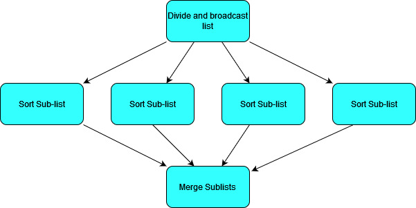
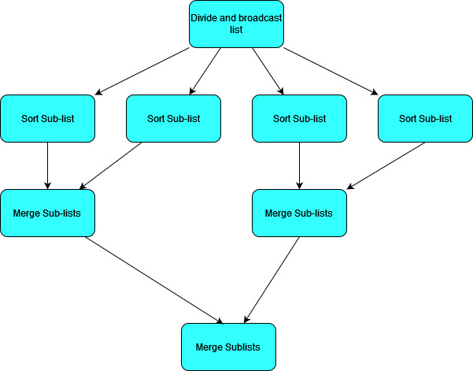
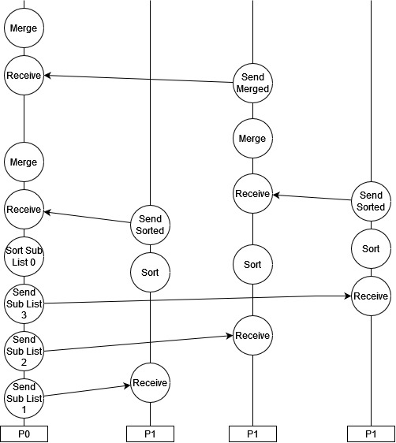
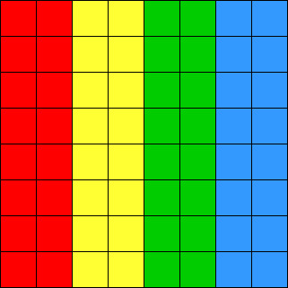
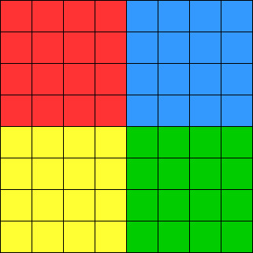

# Domain Decomposition

In order to effectively work on any parallel problem, we need to divide the problem up into smaller pieces that can be worked on in parallel. This need is especially clear when programming in MPI, since the processes do not share memory and must communicate via explicit messaging. Deciding what information should be held and worked with on which process is an important part of developing parallel designs, and can have a significant impact on the efficiency of your solution. 

## Common Models of Communication in Scientific Programming 

There are some patterns of communication that appear frequently in scientific programming, which often doesn't require the extremely free form approach of more general asynchronous systems!

### Divide, Process, and Aggregate using a Parent process

A straight-forward way of handling many problems is to assign one process the "Parent" process. This is your main process which will initialise your other processes, divide work amongst them, and aggregate data from them. It may or may not do such tasks itself! 

To give the simplest example of how this kind of model can work, let's look at it in the context of the merge-sort algorithm that we used in week 7. (Although sorting a list is not a very practical example as the communication overheads will probably be larger than the sorting time in practical cases, but we'll ignore communication time for now!)
- Merge sort calculates a sorted list by merging together sub-lists which have already been sorted. 
- So if we have $N$ child processes, the parent process can divide our list into $N$ chunks of (roughly) equal size, and ask each child to sort that list and send it back. 
- The Parent process can then merge all the sorted lists. 

We can visualise this as a flow chart like so:

In this case we could actually make things more efficient by allowing some pair-wise communication between child processes to merge sublists. 

In this case instead of one thread merging all sub-lists, we can parallelise over them. As we merge lists pairwise, we will end up with an increasing number of processes idling. 

In these flow charts we have described what needs to be done but not necessarily which processes do it. We want our Parent process to divide the list up and broadcast it, and we want our parent process to end up with the sorted list at the end, but if we want to make the most of our resources we should probably have the parent process do some of the sorting work as well in this case. If we have 4 processes $P_{0...3}$, we could arrange our processes like so:

This kind of pattern of distributing work and aggregating results often happens in a loop, so that we have the division of a task followed by a central synchronisation, followed by a divided task again and so on. 

### Communication On Grids

Grids are a common feature in scientific programming, from lattices in solid state physics and grid methods for fluid simulations, to image processing techniques. Lots of data gets defined on grids, and the processing of this data is often dependent on the data immediately surrounding it in the grid. The game of life was a simple example of this very principle! 

The highly connected nature of grids gives raises an important question for distributed memory systems: what is the most efficient to divide up a grid so that we minimise our message passing? If we want to minimise the frequency and size of our messages between processes, then we need to minimise the number of cells along the boundary of the regions delogated to each process. 

If we want to allocate this grid to four processes, how could we proceed? A simple approach would be to just split it into four vertical sections like so:

Here we've coloured the regions in four different colours to show the allocation to different processes. Any cells on the border of the coloured region will need to be broadcast to the neighbouring region(s). 
- The red and blue regions each broadcast and receive 8 cells to one other region. 
- The yellow and green regions broadcast and receive 16 cells each, split between two regions.
- In total we need to send 48 out of 64 cells, and send 6 messages. 

We can divide up this region to reduce the number of cells on the boundary by dividing the grid into squares:

- In the simplest implementation each region needs to send 9 cells in three messages: for example the red region sends it bottom row to the yellow (4 cells), its right most column to the blue (4 cells), and its bottom left cell to the green (1 cell). 
- Doing it this way would result in sending 36 cells across 12 messages, so fewer cells but more messages. 
- We can do this using fewer messages however if we introduce some blocking i.e. we make some processes wait to receive data before sending data so that they can forward on shared data. This tends to lead to time idling though! 

Which solution and message passing pattern is most efficient may depend on your system and the message passing latency and bandwidth properties! If your message passing time is dominated by bandwidth, you should try to minimise the amount of data communicated (i.e. smallest number of boundary cells); if your message passing time is dominated by latency, you should try to minimise the number of messages that you send. For problems which have to communicate large amounts of data, the message passing time will likely be bandwidth dominated and so a smaller boundary is the preferable solution. 

